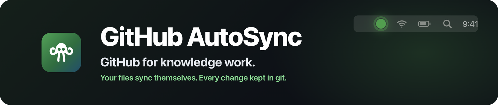
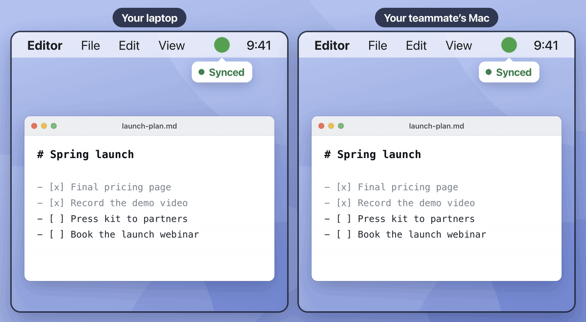
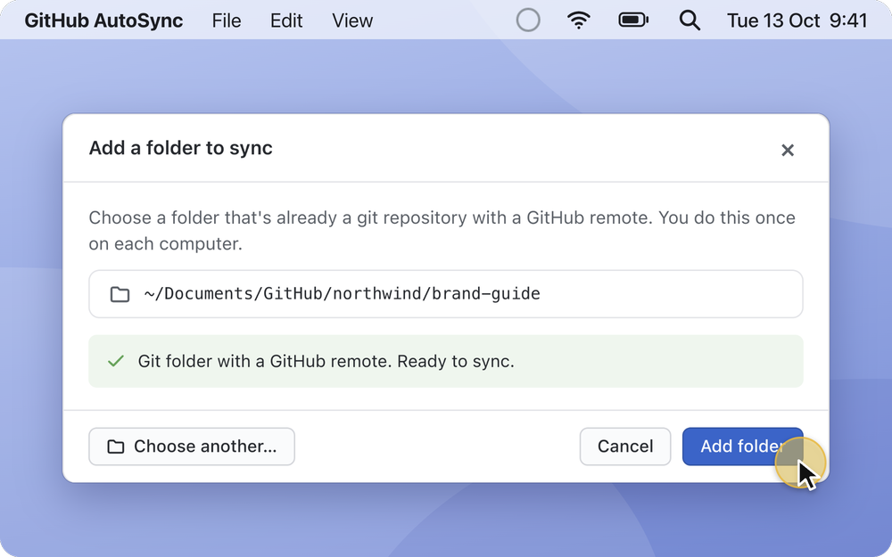
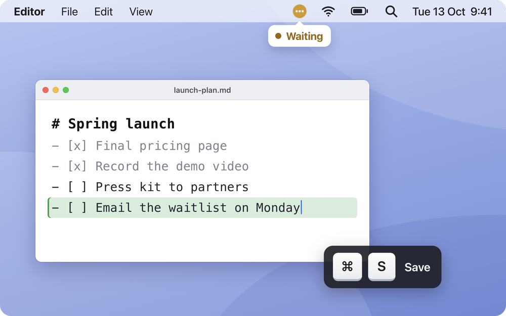
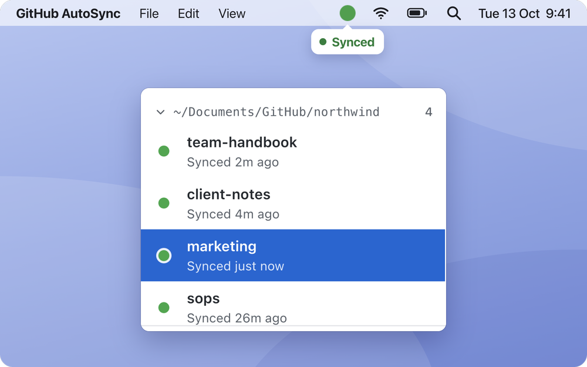
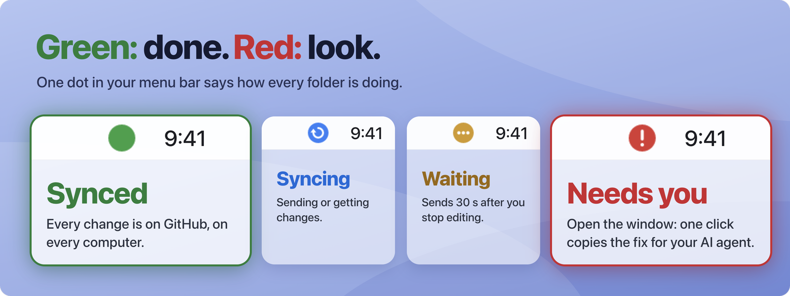
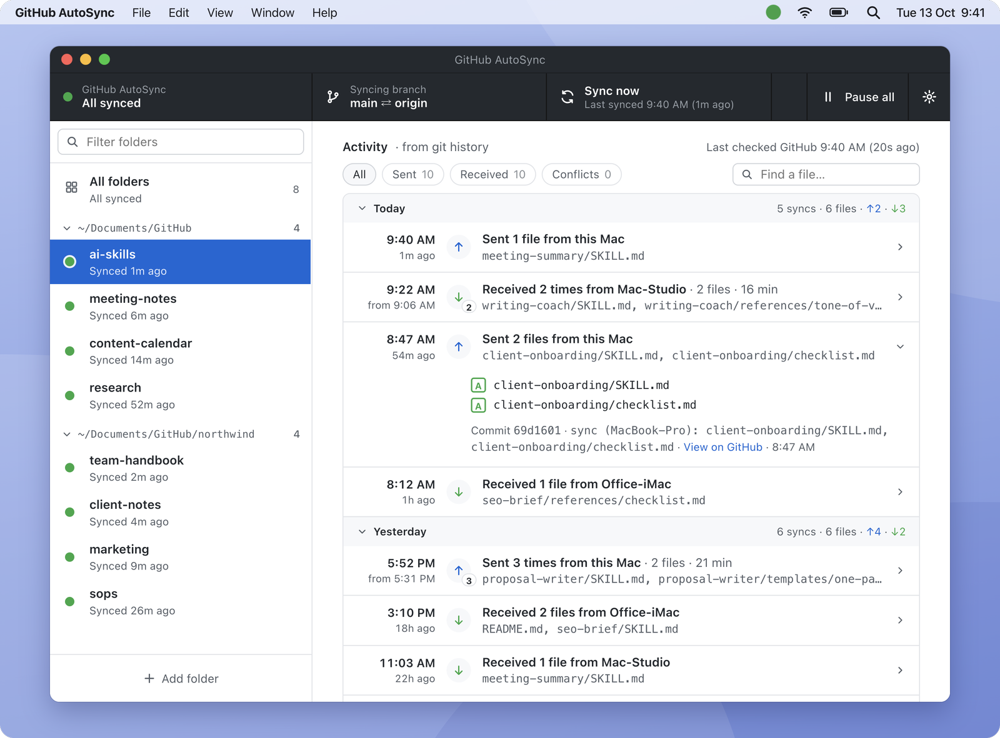
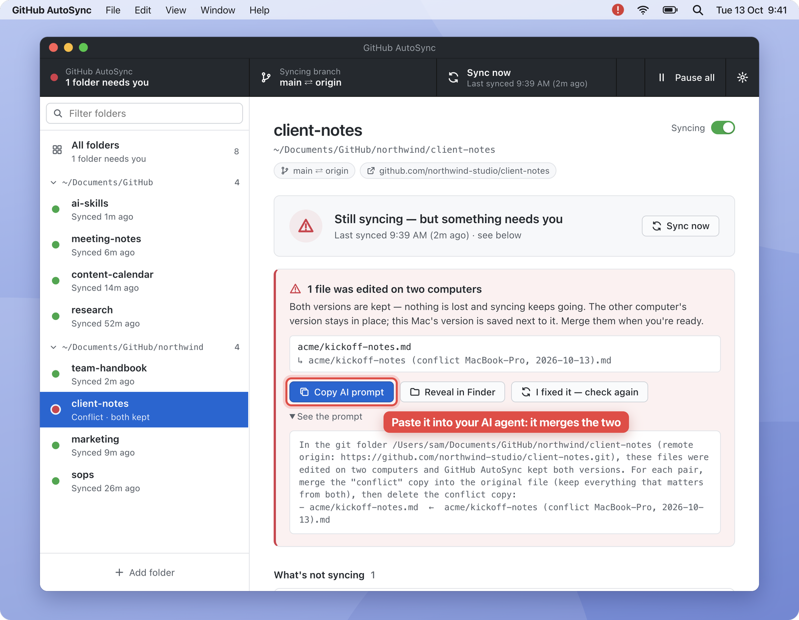
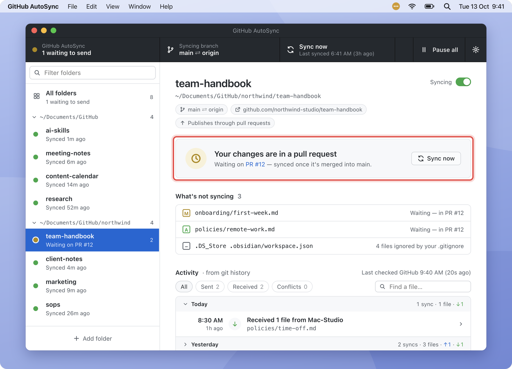
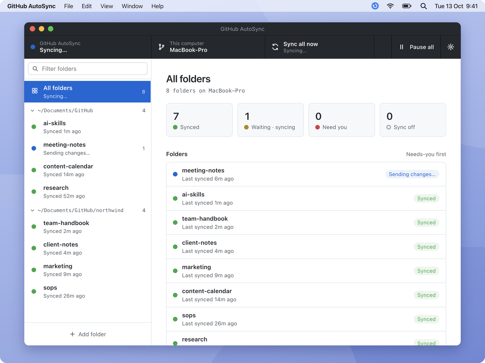

  

  
  
  

  <a href="https://github.com/yaseenarshad/github-autosync/releases/latest"><b>Download</b></a> ·
  <a href="#the-answer">How it works</a> ·
  <a href="#the-doubts">Questions</a> ·
  <a href="docs/DEVELOPMENT.md">Developers</a>

  <b>Write it on one computer. It is already on your other one, and on your team's. No commit. No push.</b>

  

  <a href="https://github.com/yaseenarshad/github-autosync/releases/latest"><b>Download for Mac or Windows</b></a> 
  Free · Open source · Uses your own GitHub · No account, no server

## The problem

GitHub was built for code. For code, "nothing syncs until you push" is a feature: you want CI, and you want to know exactly what you ship. But I keep my knowledge work in GitHub too: notes, docs, SOPs, the skills of my AI agent. An agent works best on real files on your computer. And I kept forgetting to push. I sat down at my other computer, and the file was not there. My teammate opened the folder, and they did not have it either. So I built the Google Drive for your local files, on GitHub: you save, and every computer and every teammate has it.

Maybe you know these moments:

- You wrote the doc on your laptop. You open your desktop, and it is not there.
- Your teammate needs the file now. It is on your computer, not on GitHub.
- Your AI agent changed 40 files today. Nobody committed them.
- You tried Google Drive. Your files lived in the cloud, and old versions were gone after 30 days.

  

Google Drive: Drive for desktop in its default mode, and its version history for files that are not Google Docs (Google Drive Help, October 2026). GitHub (on its own): git or GitHub Desktop, where you commit and push yourself.

## The answer

GitHub AutoSync gives you the sync of Google Drive with the history of git. It watches the git folders that you pick. 30 seconds after you stop typing, it commits and pushes. Every minute, it brings in what the others sent.

<table>
  <tr>
    <td align="center" width="33%"> <b>1. Add a folder</b> Any git folder on GitHub.</td>
    <td align="center" width="33%"> <b>2. Keep working</b> In any editor, or let your agent write.</td>
    <td align="center" width="33%"> <b>3. It is on GitHub</b> The dot turns green.</td>
  </tr>
</table>

## What it does

### Green means done. Red means look.

One dot in your menu bar tells you everything. Bright green: every folder is on GitHub. Bright red: a folder needs you, and one click shows which.

**So what:** you never wonder again if your work is saved.

  

### Every change kept, from every computer

Each save is a git commit with the name of the computer that sent it. Open a folder and see what went out, what came in, from where, and when.

**So what:** you can go back to any version, from any day. No 30-day limit. And your AI agent can read the history too.

  

### Two people, one file: nothing is lost

When the same file changes on two computers, AutoSync keeps both versions side by side, and syncing goes on. One click copies a prompt that tells your AI agent how to merge them.

**So what:** no merge screen, no lost paragraph. Your agent does the cleanup.

  

### Works with your team's rules

Does your team repo take changes only through pull requests? AutoSync opens one pull request for each sitting, 5 minutes after your last edit. When the repo merges it, your folder turns green.

**So what:** the team keeps its review rules, and you still never type a git command.

  

### All your folders in one window

  

And the small things:

- It starts at login, and it leaves the Dock when you close its window.
- Right-click a folder to open it in Finder, Terminal, VS Code or on GitHub, or to give it a nickname.
- Your `.gitignore` decides what syncs. A file too big for GitHub is never sent, and the window lists it.
- Pause everything with one click.
- Light and dark look.

## The proof

- **30 seconds** after you stop typing, your change is on GitHub.
- **Every minute**, it checks for the changes of your other computers and your team.
- **360 automated tests** run against real git, on Mac and on Windows, for every pull request to the app.
- **0 accounts, 0 servers, 0 tracking.** The app talks only to your own GitHub, through git.
- **Never a merge commit.** Your history stays clean.

## The doubts

**Will it mess up my code repos?**
It syncs only the folders that you add. Keep your code repos out, and give it your knowledge folders. If you start a merge or a rebase by hand, it waits until you finish.

**Where do my files go?**
Only to your own repo on GitHub, through your own git. There is no AutoSync account and no AutoSync server.

**Does it cost money?**
No. It is free and open source, and private repos on GitHub are free.

**Why does my computer warn me at the first start?**
The app does not come from an app store, so macOS and Windows ask you one time. Step 4 below shows the one click.

## The download

  <a href="https://github.com/yaseenarshad/github-autosync/releases/latest"><b>Download the newest version</b></a> 
  Mac with Apple Silicon (<code>.dmg</code>) · Windows 64-bit (<code>-setup.exe</code>) · Needs git and the GitHub CLI

1. Install git and the GitHub CLI. Mac: `brew install git gh`. Windows: `winget install Git.Git`, then `winget install GitHub.cli`.
2. Sign in to GitHub: `gh auth login`, then `gh auth setup-git`.
3. Clone the repo that you want to sync.
4. Install and open GitHub AutoSync. On a Mac, the first time: System Settings → Privacy & Security → **Open Anyway**. On Windows: **More info** → **Run anyway**.
5. Click **Add folder** and pick the clone.

Then try this:

1. Change a file in that folder. Watch the dot turn amber, then green, in about 30 seconds.
2. Open the repo on GitHub. Your change is there as `sync (<your computer>): <file>`.
3. Add the same repo on your other computer, or give it to a teammate. Change a file there, and watch it arrive here.

## For developers

GitHub AutoSync is an Electron and React app, with a sync engine on plain git. How to build, test and release it: [docs/DEVELOPMENT.md](docs/DEVELOPMENT.md). Exactly how it behaves: [docs/CONTRACTS.md](docs/CONTRACTS.md).

Licence: [MIT](LICENSE).
